# Automatización de pruebas – AutomatizacionDePruebas

Repositorio con el desarrollo de las actividades de la asignatura Automatización de Pruebas. Cada actividad se documenta en su propia sección, junto a sus evidencias:

- **Actividad 1:** integración continua con Maven, JUnit y GitHub Actions.
- **Actividad 2:** BDD con Cucumber, pruebas de performance con k6, dashboard de métricas y alertas automáticas.

---

## Actividad 1 – Integración continua con Maven, JUnit y GitHub Actions

Proyecto Java que implementa un flujo básico de integración continua (CI): control de versiones con Git, gestión de dependencias con Maven, pruebas unitarias atómicas con JUnit y un pipeline en GitHub Actions que compila, ejecuta las pruebas y publica un reporte navegable en cada push o pull request.

### Objetivos

- Profesionalizar el proceso de pruebas automatizadas de un proyecto Java.
- Gestionar versiones con ramas por funcionalidad y commits frecuentes con mensajes claros.
- Configurar dependencias de pruebas de forma reproducible mediante Maven.
- Implementar pruebas unitarias atómicas e independientes.
- Automatizar la compilación y ejecución de pruebas en un pipeline de CI con reporte accesible para el equipo.

### Integración continua

La integración continua es una práctica que consiste en integrar con frecuencia los cambios de código en un repositorio compartido. Cada integración dispara automáticamente un pipeline que compila el código, ejecuta las pruebas automatizadas y entrega feedback inmediato al equipo.

**Beneficios:**

- Detecta errores de forma temprana, evitando la acumulación de defectos.
- Entrega feedback rápido a los desarrolladores en cada cambio.
- Aumenta la transparencia: todo el equipo conoce el estado del proyecto.
- Reduce riesgos y mejora la calidad del software entregado.

### Requisitos del entorno

| Herramienta | Versión |
|---|---|
| JDK | 21 |
| Apache Maven | 3.9.x |
| Git | 2.x |

### Instrucciones de uso

```bash
# Clonar el repositorio
git clone https://github.com/Lito-git/AutomatizacionDePruebas.git
cd AutomatizacionDePruebas

# Compilar y ejecutar las pruebas
mvn clean test

# Generar el reporte HTML de pruebas
mvn surefire-report:report-only site -DgenerateReports=false
```

El reporte queda en `target/reports/surefire.html` y se abre directamente en el navegador.

### Estructura del proyecto

*Estructura al cierre de la Actividad 1. La estructura actualizada está en la sección de la Actividad 2.*

```
AutomatizacionDePruebas/
├── .github/
│   └── workflows/
│       └── ci.yml              # Pipeline de integración continua
├── docs/
│   └── evidencias/             # Capturas de ejecución local y en CI
├── src/
│   ├── main/java/com/iplacex/
│   │   └── Calculadora.java    # Lógica de negocio (suma y resta)
│   └── test/java/com/iplacex/
│       ├── SumaTest.java       # Pruebas unitarias de suma
│       └── RestaTest.java      # Pruebas unitarias de resta
├── .gitignore                  # Exclusiones de archivos generados
├── pom.xml                     # Configuración Maven: dependencias y plugins
└── README.md
```

El proyecto sigue la estructura estándar de Maven: el código de producción en `src/main/java` y las pruebas en `src/test/java`, en el mismo paquete. Maven ejecuta automáticamente las pruebas de `src/test/java` en la fase `test` de su ciclo de vida.

### Archivos clave

| Archivo | Función |
|---|---|
| `pom.xml` | Define JUnit 4.13.2 con ámbito `test`, Java 21 y versiones explícitas de los plugins de compilación, ejecución de pruebas (Surefire) y reporte HTML. |
| `Calculadora.java` | Clase sin estado con las operaciones `sumar` y `restar`. |
| `SumaTest.java` / `RestaTest.java` | Pruebas unitarias atómicas: cada test verifica un solo comportamiento y usa una instancia nueva creada en `@Before`, por lo que ningún test depende de otro. |
| `.gitignore` | Excluye la carpeta `target/`, archivos compilados, configuraciones del IDE y archivos del sistema operativo. |
| `ci.yml` | Define el pipeline de GitHub Actions. |

### Archivo .gitignore

El archivo `.gitignore` evita subir al repositorio archivos temporales, compilados y generados por el build (`target/`, `*.class`), además de configuraciones locales del IDE (`.idea/`, `*.iml`, `.vscode/`). Así el repositorio contiene solo código y configuración relevante, y cada build parte de un entorno limpio.

### Flujo de trabajo con Git

- `main` contiene siempre código estable y validado.
- Cada cambio se desarrolla en una rama por tipo: `feature/` para funcionalidades y `docs/` para documentación.
- Los commits son pequeños, uno por cambio lógico, con el formato `tipo: descripción` (`feat`, `test`, `ci`, `docs`, `chore`).
- Los cambios se integran a `main` mediante pull request, solo después de que el pipeline valida el código.

### Pipeline de integración continua

*Pipeline al cierre de la Actividad 1. Su versión ampliada está en la sección de la Actividad 2.*

El pipeline se define en `.github/workflows/ci.yml` y se ejecuta automáticamente en cada push a las ramas `main`, `feature/**` y `docs/**`, y en cada pull request hacia `main`.

| Paso | Acción |
|---|---|
| 1. Checkout del código | Descarga el repositorio en el agente de GitHub Actions. |
| 2. Configurar JDK 21 | Instala el mismo JDK del entorno local y cachea las dependencias Maven para acelerar los builds. |
| 3. Compilar y ejecutar pruebas | Ejecuta `mvn clean test`; si alguna prueba falla, el pipeline falla y el pull request queda bloqueado. |
| 4. Generar reporte HTML | Crea el reporte navegable de pruebas, incluso si hubo fallos. |
| 5. Publicar reporte | Sube el reporte HTML y los resultados XML como artefacto `reporte-pruebas`. |

**Acceso a los resultados:** en la pestaña **Actions** del repositorio se ve el estado de cada ejecución. Dentro de una ejecución, la sección **Artifacts** permite descargar `reporte-pruebas` y abrir `reports/surefire.html` en el navegador. En los pull requests, el resultado aparece como check obligatorio antes del merge.

### Evidencias de la Actividad 1

**Ejecución local de las pruebas**


**Historial de commits**


**Reporte HTML de pruebas**


**Ejecución del pipeline en GitHub Actions**


**Pruebas ejecutadas en CI**


**Reporte publicado como artefacto**


**Pull request validado por el pipeline**


---

## Actividad 2 – BDD, pruebas de performance, dashboard y alertas

### Objetivo y alcance

Llevar las pruebas del proyecto a un nivel superior, aplicando desarrollo guiado por comportamiento (BDD) y mejorando la visibilidad y calidad de los resultados. La funcionalidad elegida es el **inicio de sesión**, sobre la cual se:

- definieron los criterios de aceptación en una sesión Three Amigos;
- automatizaron escenarios Gherkin con Cucumber, integrados al pipeline de CI con reporte navegable;
- diseñó una prueba de carga con k6 con umbrales de rendimiento;
- agregaron un dashboard de métricas y alertas automáticas ante fallos o degradaciones.

Quedan fuera del alcance la recuperación de contraseña, el registro de usuarios y el bloqueo por intentos fallidos.

### Sesión Three Amigos

| Rol | Aporte en la sesión |
|---|---|
| Negocio (Product Owner) | Definió el objetivo, el alcance y las reglas de negocio. |
| QA (Analista QA) | Propuso ejemplos concretos, casos límite y criterios verificables. |
| Desarrollo (Desarrollador) | Evaluó la viabilidad técnica y definió los datos de prueba. |

**Criterios de aceptación acordados:**

| Código | Criterio |
|---|---|
| CA1 | Con credenciales válidas, el usuario accede y ve "Bienvenido, <nombre>". |
| CA2 | Con contraseña incorrecta, el acceso se rechaza con "Credenciales inválidas". |
| CA3 | Con correo no registrado, el acceso se rechaza con el mismo mensaje "Credenciales inválidas", para no revelar si el correo existe. |
| CA4 | Con correo o contraseña vacíos, se muestra "Debe ingresar correo y contraseña". |

**Ejemplos discutidos** (usuario de prueba: `ana@iplacex.cl` / `Clave123` / Ana):

| Correo | Contraseña | Resultado esperado | Criterio |
|---|---|---|---|
| ana@iplacex.cl | Clave123 | Bienvenido, Ana | CA1 |
| ana@iplacex.cl | ClaveMala | Credenciales inválidas | CA2 |
| otro@iplacex.cl | Clave123 | Credenciales inválidas | CA3 |
| (vacío) | Clave123 | Debe ingresar correo y contraseña | CA4 |
| ana@iplacex.cl | (vacío) | Debe ingresar correo y contraseña | CA4 |

### Requisitos adicionales del entorno

Además de los requisitos de la Actividad 1:

| Herramienta | Uso |
|---|---|
| k6 | Ejecución local de la prueba de carga (`winget install k6 --source winget`). |

Cucumber se descarga automáticamente con Maven.

### Estructura del proyecto actualizada

```
AutomatizacionDePruebas/
├── .github/workflows/ci.yml                  # Pipeline: pruebas, BDD, performance, dashboard y alertas
├── docs/evidencias/                          # Capturas de la Actividad 1
│   └── actividad2/                           # Capturas de la Actividad 2
├── performance/
│   └── login-carga.js                        # Prueba de carga con k6
├── scripts/
│   └── resumen_metricas.py                   # Dashboard de métricas del pipeline
├── src/
│   ├── main/java/com/iplacex/
│   │   ├── Calculadora.java
│   │   └── login/
│   │       ├── ServicioAutenticacion.java    # Lógica del inicio de sesión
│   │       └── ServidorLogin.java            # Endpoint HTTP POST /login
│   └── test/
│       ├── java/com/iplacex/
│       │   ├── SumaTest.java
│       │   ├── RestaTest.java
│       │   ├── RunCucumberTest.java          # Runner de Cucumber
│       │   └── steps/
│       │       └── LoginSteps.java           # Step definitions
│       └── resources/features/
│           └── login.feature                 # Escenarios Gherkin
├── .gitignore
├── pom.xml
└── README.md
```

### Archivos clave

| Archivo | Función |
|---|---|
| `login.feature` | Escenarios en Gherkin: un Background con el usuario de prueba, un Scenario de inicio de sesión exitoso y un Scenario Outline con Examples para los casos de rechazo. |
| `LoginSteps.java` | Step definitions delgados: traducen cada paso y delegan la lógica en `ServicioAutenticacion`. |
| `RunCucumberTest.java` | Runner que ejecuta los escenarios con JUnit y genera los reportes HTML y JSON. |
| `ServicioAutenticacion.java` | Implementa los criterios de aceptación del inicio de sesión. |
| `ServidorLogin.java` | Expone el inicio de sesión en `POST /login` para la prueba de carga. |
| `login-carga.js` | Prueba de carga con 20 usuarios virtuales y umbrales de latencia, errores y TPS. |
| `resumen_metricas.py` | Lee los resultados de Surefire, Cucumber y k6, y publica el dashboard en el resumen de cada ejecución. |

### Ejecución local

```bash
# Escenarios BDD (genera target/cucumber-report.html)
mvn clean test -Dtest=RunCucumberTest

# Prueba de carga
# Terminal 1: levantar el servidor de login
mvn compile
java -cp target/classes com.iplacex.login.ServidorLogin

# Terminal 2: ejecutar k6 (genera target/reporte-performance.html)
k6 run --out web-dashboard=export=target/reporte-performance.html --summary-export=target/k6-resumen.json performance/login-carga.js
```

### Prueba de performance

La prueba simula 20 usuarios virtuales concurrentes durante 50 segundos (10 s de subida, 30 s sostenidos y 10 s de bajada) enviando credenciales válidas a `POST /login`.

| Indicador | Métrica de k6 | Umbral |
|---|---|---|
| Latencia | `http_req_duration` p(95) | < 500 ms |
| Errores | `http_req_failed` | < 1 % |
| TPS | `http_reqs` (rate) | > 50 solicitudes por segundo |

Si algún umbral no se cumple, k6 termina con error y el pipeline falla.

### Pipeline de integración continua

| Job | Pasos principales | Se ejecuta |
|---|---|---|
| `build-and-test` | Pruebas unitarias, escenarios BDD, reportes y dashboard funcional | En cada push y pull request |
| `performance` | Servidor de login, prueba de carga con k6, reporte y dashboard de performance | Solo si `build-and-test` pasa |
| `alerta` | Crea un issue con el detalle del fallo | Solo si algún job anterior falla |

### Reportes y dashboard

Cada ejecución publica tres artefactos, descargables desde la sección **Artifacts** de la ejecución en la pestaña **Actions**:

| Artefacto | Contenido |
|---|---|
| `reporte-pruebas` | Reporte HTML de Surefire (`reports/surefire.html`). |
| `reporte-bdd` | Reporte navegable de Cucumber (`cucumber-report.html`) y su JSON. |
| `reporte-performance` | Reporte HTML de k6 con gráficos de la prueba (`reporte-performance.html`) y su JSON. |

Además, la página **Summary** de cada ejecución muestra el dashboard de calidad con dos tablas:
- pruebas unitarias y escenarios BDD ejecutados y exitosos;
- TPS, latencia p95 y promedio, tasa de errores y checks.

Cada indicador con umbral se marca con ✅ o ❌.

### Alertas automáticas

Cuando un job falla o el rendimiento se degrada:

1. El job `alerta` crea automáticamente un **issue** en el repositorio con la rama, el commit, el autor, el resultado de cada job y el enlace a la ejecución.
2. GitHub envía una **notificación por correo** al autor del cambio.
3. Una vez corregida la causa, el issue se cierra con un comentario que documenta la causa, la acción tomada y la verificación.

### Evidencias de la Actividad 2

**Escenarios BDD ejecutados localmente**
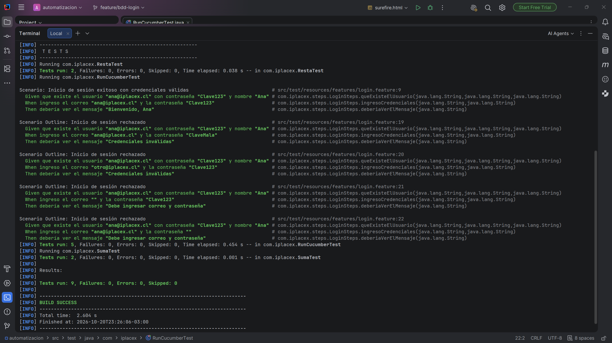

**Reporte navegable de Cucumber**
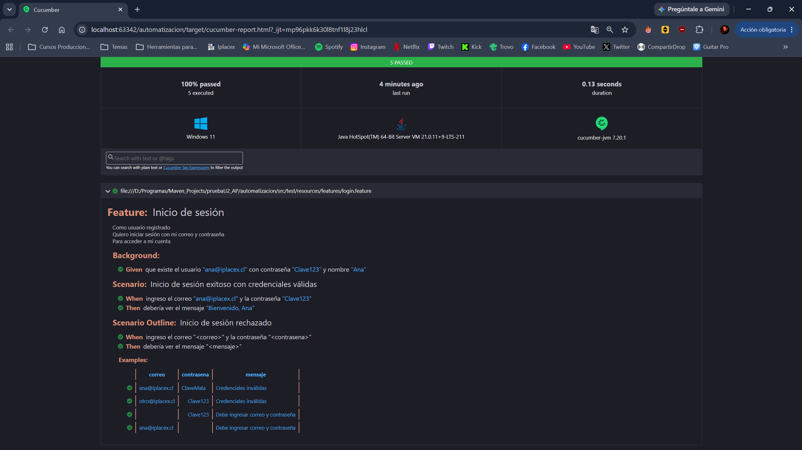

**Escenarios BDD ejecutados en CI**
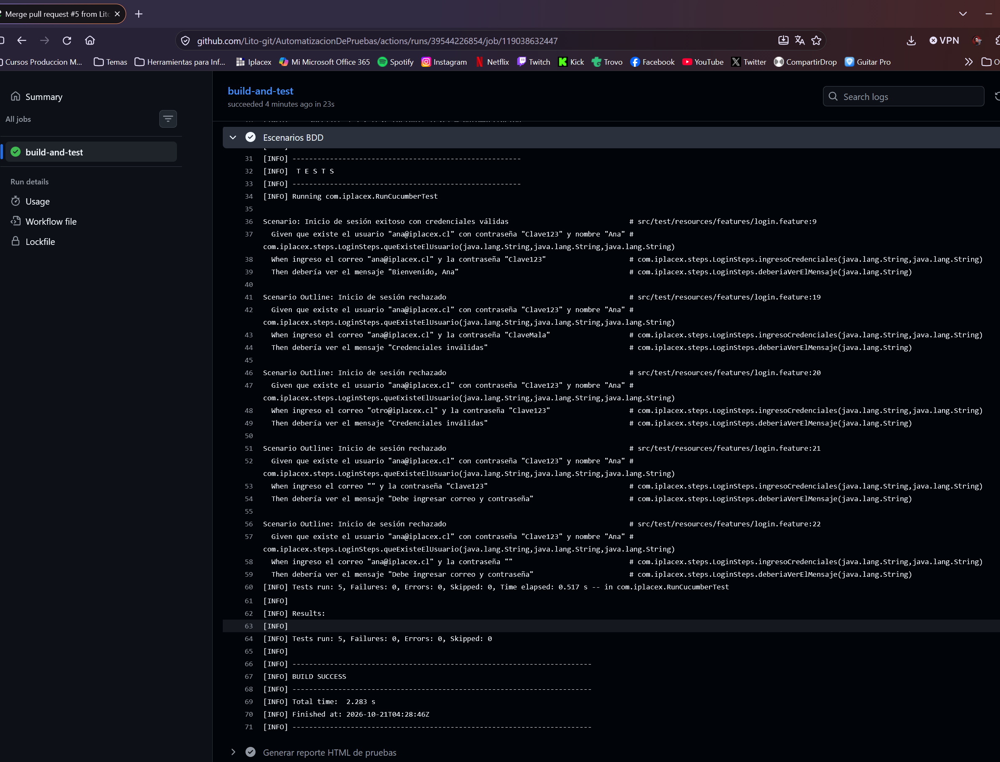

**Prueba de carga local con k6**
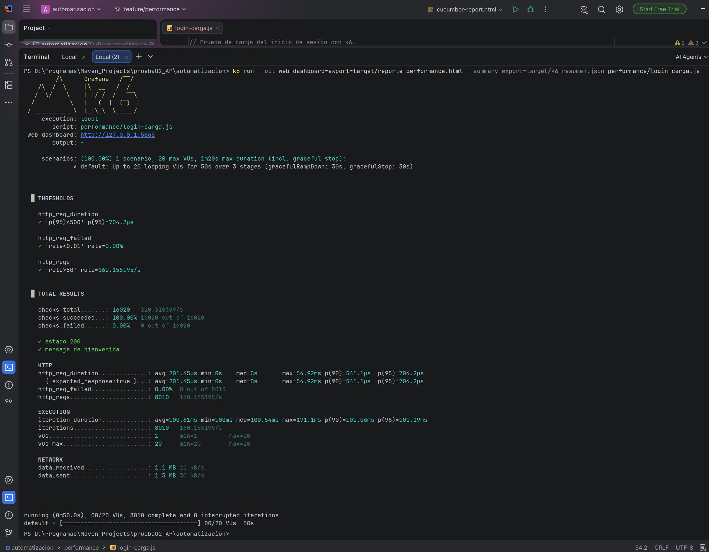

**Reporte de performance**
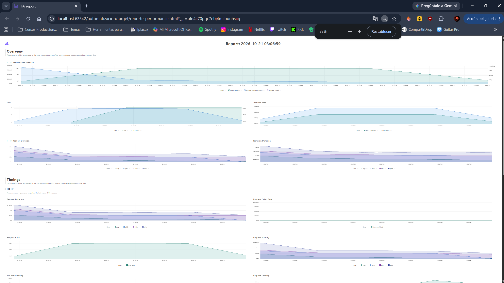

**Pipeline con jobs funcionales y de performance**
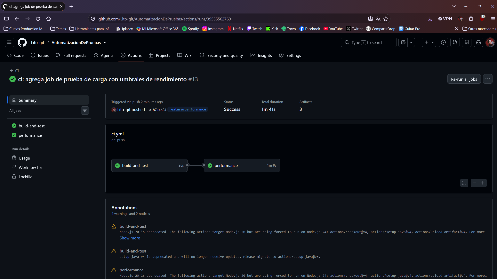

**Artefactos publicados**
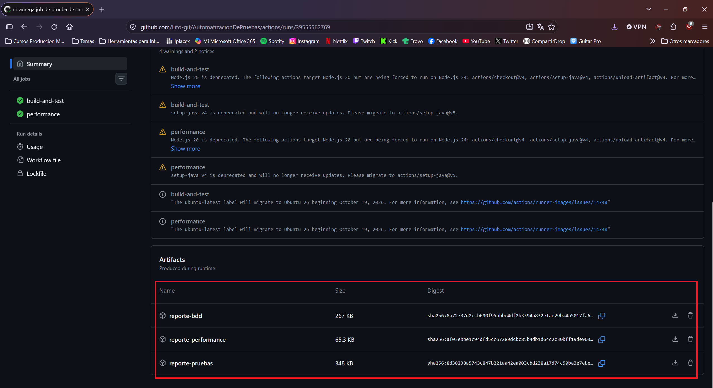

**Dashboard de métricas**
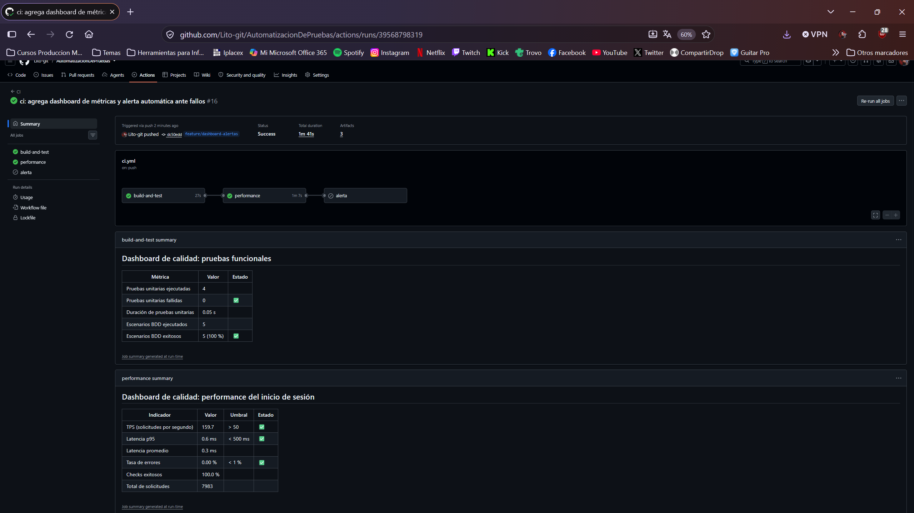

**Pipeline fallido por degradación simulada**
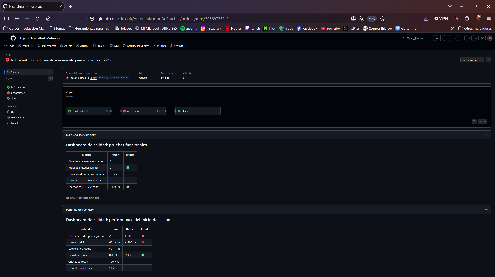

**Dashboard reflejando la degradación**
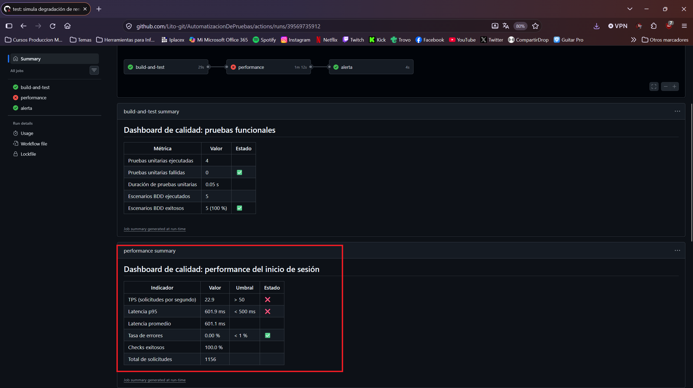

**Issue de alerta creado automáticamente**
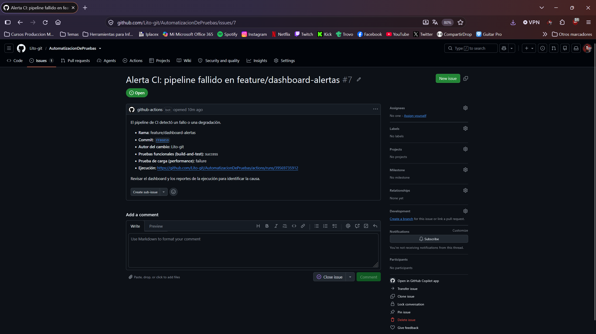

**Alerta resuelta y cerrada**
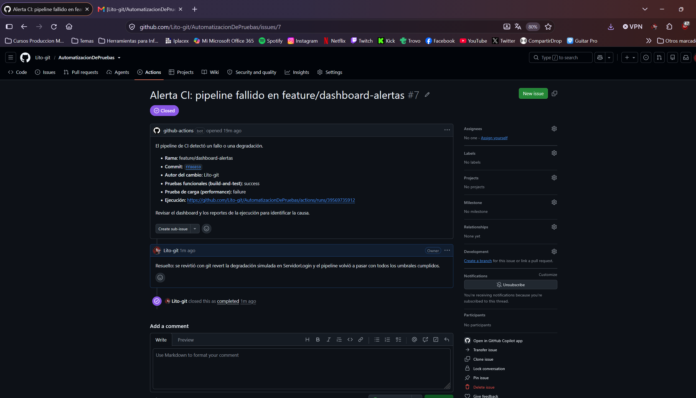