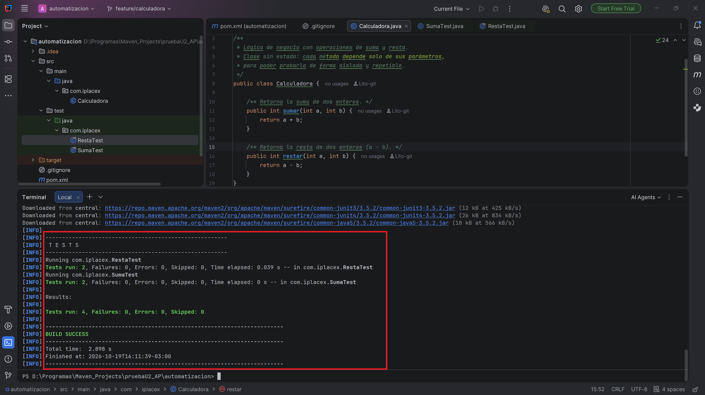
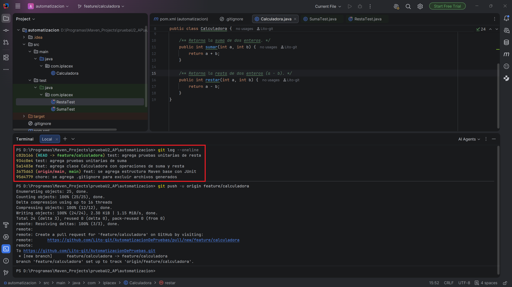
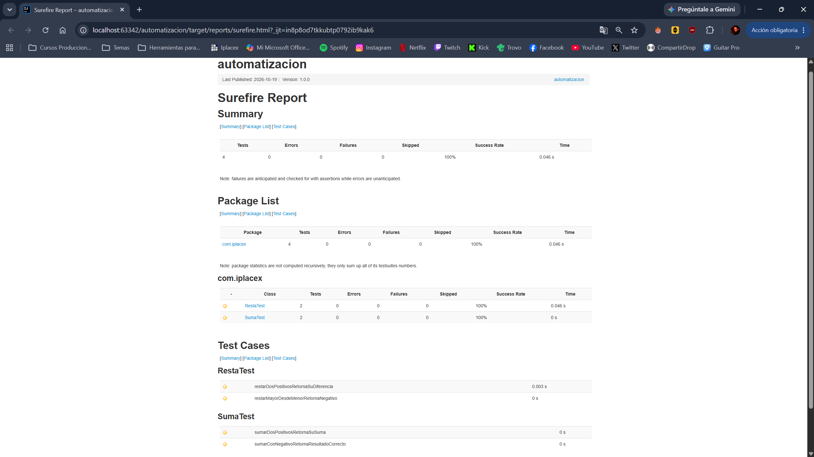
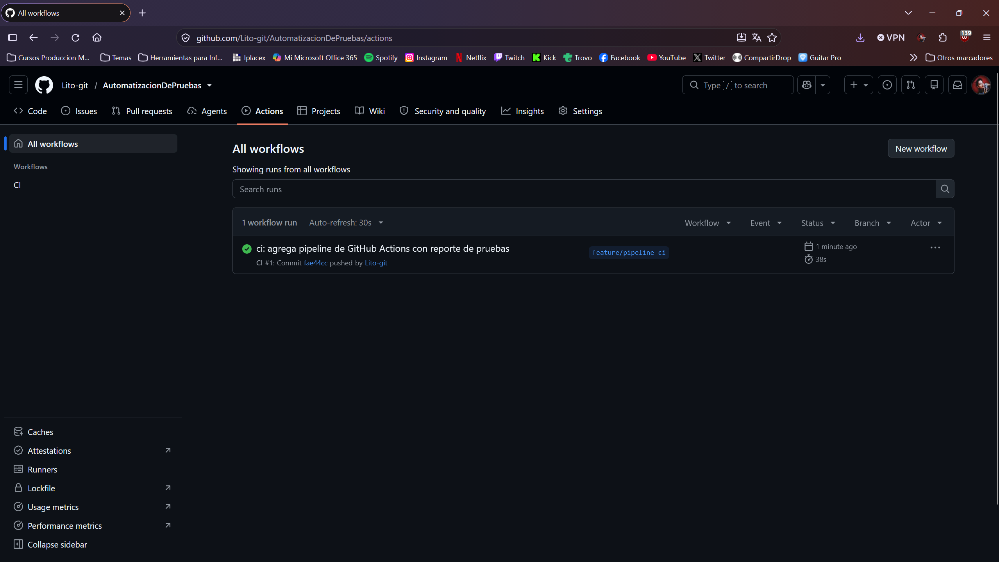
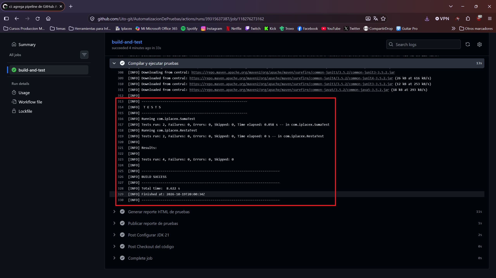
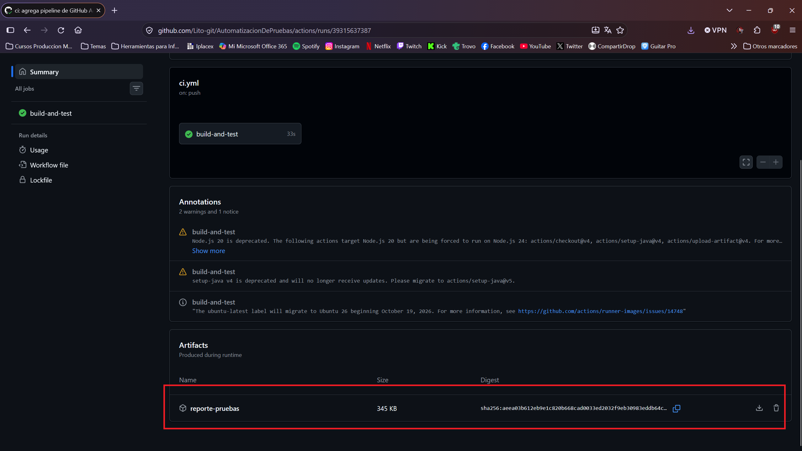
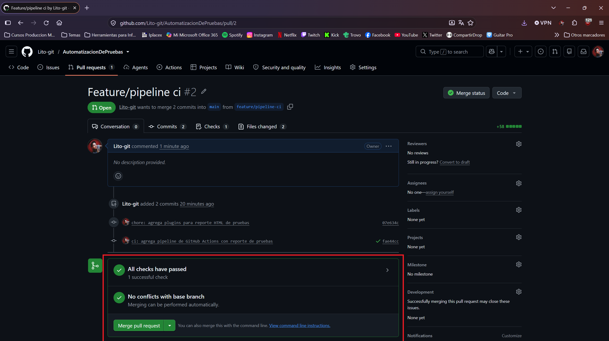

# Automatización de pruebas – Integración continua con Maven, JUnit y GitHub Actions

Proyecto Java que implementa un flujo básico de integración continua (CI): control de versiones con Git, gestión de dependencias con Maven, pruebas unitarias atómicas con JUnit y un pipeline en GitHub Actions que compila, ejecuta las pruebas y publica un reporte navegable en cada push o pull request.

## Objetivos

- Profesionalizar el proceso de pruebas automatizadas de un proyecto Java.
- Gestionar versiones con ramas por funcionalidad y commits frecuentes con mensajes claros.
- Configurar dependencias de pruebas de forma reproducible mediante Maven.
- Implementar pruebas unitarias atómicas e independientes.
- Automatizar la compilación y ejecución de pruebas en un pipeline de CI con reporte accesible para el equipo.

## Integración continua

La integración continua es una práctica que consiste en integrar con frecuencia los cambios de código en un repositorio compartido. Cada integración dispara automáticamente un pipeline que compila el código, ejecuta las pruebas automatizadas y entrega feedback inmediato al equipo.

**Beneficios:**

- Detecta errores de forma temprana, evitando la acumulación de defectos.
- Entrega feedback rápido a los desarrolladores en cada cambio.
- Aumenta la transparencia: todo el equipo conoce el estado del proyecto.
- Reduce riesgos y mejora la calidad del software entregado.

## Requisitos del entorno

| Herramienta | Versión |
|---|---|
| JDK | 21 |
| Apache Maven | 3.9.x |
| Git | 2.x |

## Instrucciones de uso

```bash
# Clonar el repositorio
git clone https://github.com/Lito-git/AutomatizacionDePruebas.git
cd AutomatizacionDePruebas

# Compilar y ejecutar las pruebas
mvn clean test

# Generar el reporte HTML de pruebas
mvn surefire-report:report-only site -DgenerateReports=false
```

El reporte queda en `target/reports/surefire.html` y se abre directamente en el navegador.

## Estructura del proyecto

```
AutomatizacionDePruebas/
├── .github/
│   └── workflows/
│       └── ci.yml              # Pipeline de integración continua
├── docs/
│   └── evidencias/             # Capturas de ejecución local y en CI
├── src/
│   ├── main/java/com/iplacex/
│   │   └── Calculadora.java    # Lógica de negocio (suma y resta)
│   └── test/java/com/iplacex/
│       ├── SumaTest.java       # Pruebas unitarias de suma
│       └── RestaTest.java      # Pruebas unitarias de resta
├── .gitignore                  # Exclusiones de archivos generados
├── pom.xml                     # Configuración Maven: dependencias y plugins
└── README.md
```

El proyecto sigue la estructura estándar de Maven: el código de producción en `src/main/java` y las pruebas en `src/test/java`, en el mismo paquete. Maven ejecuta automáticamente las pruebas de `src/test/java` en la fase `test` de su ciclo de vida.

## Archivos clave

| Archivo | Función |
|---|---|
| `pom.xml` | Define JUnit 4.13.2 con ámbito `test`, Java 21 y versiones explícitas de los plugins de compilación, ejecución de pruebas (Surefire) y reporte HTML. |
| `Calculadora.java` | Clase sin estado con las operaciones `sumar` y `restar`. |
| `SumaTest.java` / `RestaTest.java` | Pruebas unitarias atómicas: cada test verifica un solo comportamiento y usa una instancia nueva creada en `@Before`, por lo que ningún test depende de otro. |
| `.gitignore` | Excluye la carpeta `target/`, archivos compilados, configuraciones del IDE y archivos del sistema operativo. |
| `ci.yml` | Define el pipeline de GitHub Actions. |

## Archivo .gitignore

El archivo `.gitignore` evita subir al repositorio archivos temporales, compilados y generados por el build (`target/`, `*.class`), además de configuraciones locales del IDE (`.idea/`, `*.iml`, `.vscode/`). Así el repositorio contiene solo código y configuración relevante, y cada build parte de un entorno limpio.

## Flujo de trabajo con Git

- `main` contiene siempre código estable y validado.
- Cada cambio se desarrolla en una rama por tipo: `feature/` para funcionalidades y `docs/` para documentación.
- Los commits son pequeños, uno por cambio lógico, con el formato `tipo: descripción` (`feat`, `test`, `ci`, `docs`, `chore`).
- Los cambios se integran a `main` mediante pull request, solo después de que el pipeline valida el código.

## Pipeline de integración continua

El pipeline se define en `.github/workflows/ci.yml` y se ejecuta automáticamente en cada push a las ramas `main`, `feature/**` y `docs/**`, y en cada pull request hacia `main`.

| Paso | Acción |
|---|---|
| 1. Checkout del código | Descarga el repositorio en el agente de GitHub Actions. |
| 2. Configurar JDK 21 | Instala el mismo JDK del entorno local y cachea las dependencias Maven para acelerar los builds. |
| 3. Compilar y ejecutar pruebas | Ejecuta `mvn clean test`; si alguna prueba falla, el pipeline falla y el pull request queda bloqueado. |
| 4. Generar reporte HTML | Crea el reporte navegable de pruebas, incluso si hubo fallos. |
| 5. Publicar reporte | Sube el reporte HTML y los resultados XML como artefacto `reporte-pruebas`. |

**Acceso a los resultados:** en la pestaña **Actions** del repositorio se ve el estado de cada ejecución. Dentro de una ejecución, la sección **Artifacts** permite descargar `reporte-pruebas` y abrir `reports/surefire.html` en el navegador. En los pull requests, el resultado aparece como check obligatorio antes del merge.

## Evidencias

**Ejecución local de las pruebas**


**Historial de commits**


**Reporte HTML de pruebas**


**Ejecución del pipeline en GitHub Actions**


**Pruebas ejecutadas en CI**


**Reporte publicado como artefacto**


**Pull request validado por el pipeline**
